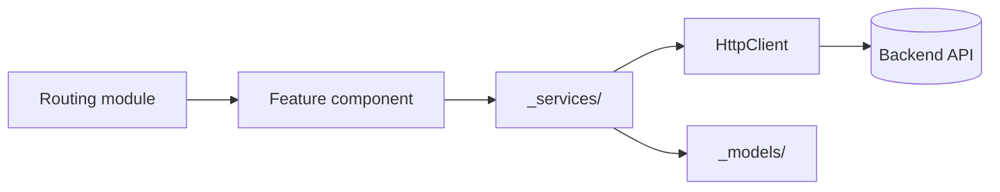

# Stack: Angular CLI

Snippets for `{{STACK:<name>}}` markers. Based on an Angular 20 CLI application (module-based, Angular Material and Bootstrap, Karma/Jasmine unit tests, Playwright under `e2e/`). Values marked "verify" differ between projects; confirm them in step 1 of `APPLY.md`. Commands use the `{{RUN:…}}`, `{{EXEC:…}}`, and `{{DLX:…}}` forms from step 3 of `APPLY.md` and never name a package manager; check each script name against `package.json`.

### profile-defaults

| Variable | Typical value |
| --- | --- |
| `{{FRAMEWORK_DOCS}}` | `https://angular.dev` (match the installed major in `package.json`; APIs changed across versions) |
| `{{SOURCE_DIR}}` | `` `src/app/` `` |
| `{{STYLE_TOKENS_FILE}}` | `src/styles.scss` (verify; may be `src/assets/scss/` in template-based apps) |
| `{{E2E_DIR}}` / `{{E2E_CONFIG}}` | `e2e/tests` / `e2e/playwright.config.ts` |
| `{{CMD_DEV}}` / `{{CMD_BUILD}}` | `{{RUN:start}}` / `{{RUN:build}}` |
| `{{CMD_LINT}}` / `{{CMD_TYPECHECK}}` | `{{RUN:lint}}` / `{{EXEC:tsc --noEmit --incremental -p tsconfig.app.json}}` (verify the tsconfig name) |
| `{{CMD_TEST}}` | `{{RUN:test --watch=false --browsers=ChromeHeadless}}` |
| `{{CMD_TEST_WATCH}}` | `{{RUN:test}}` |
| `{{CMD_TEST_FILE}}` | `{{RUN:test --watch=false --browsers=ChromeHeadless --include=<file>}}` |
| `{{CMD_TEST_RELATED}}` | `{{RUN:test --watch=false --browsers=ChromeHeadless --include=<spec> --include=<spec>}}` with the specs of the touched files and of the files that import them (Karma has no import-graph mode) |
| `{{CMD_LINT_FILES}}` | `{{EXEC:eslint --cache <files>}}` (verify the project uses `angular-eslint` with an ESLint config) |
| `{{CMD_E2E}}` | `{{EXEC:playwright test --config=e2e/playwright.config.ts}}` |

### toolchain

- Angular CLI (`ng`), TypeScript, Angular Material, and the existing CSS framework and jQuery plugins the template brought in. Preserve those integrations unless the task requires changing them.
- `ng serve` uses `src/environments/environment.ts`; production builds replace it with `environment.prod.ts` through `angular.json` file replacements. Backend URLs live there; never hardcode them in components.
- Read the Angular documentation for the installed major before using an API that changed between versions (control flow syntax, signals, standalone components, typed forms).

### architecture

- Backend and API orchestration live in services grouped by domain (`src/app/_services/<domain>/` or `services/`); shared domain types in `src/app/_models/`.
- Components hold view state and user interaction only. Move business rules and HTTP calls into services.
- Do not introduce standalone-component patterns into module-based areas unless the surrounding code already uses them, and vice versa.
- Keep subscriptions and asynchronous flows easy to reason about; unsubscribe or use `takeUntilDestroyed`/`async` pipe for long-lived streams.

### ui-rules

- One component per folder with the established files: `*.component.ts`, `*.component.html`, `*.component.scss|less`, `*.component.spec.ts`.
- Prefer typed reactive forms when touching form behavior, while respecting local patterns.
- Use Angular Material and the project's components through their accessibility props (labels, `aria-*`, `matTooltip`) instead of custom markup. Every control has an accessible name and visible focus; do not convey meaning by color alone.
- Keep templates readable: extract child components when a template grows or mixes concerns.

### test-layers

- Unit tests: Angular `TestBed`, Jasmine, Karma with ChromeHeadless. Co-located `*.spec.ts` under `src/`, included by `angular.json`. Mock `Router`, `ActivatedRoute`, and domain services; use `HttpClientTestingModule` / `provideHttpClientTesting` for HTTP; use `NO_ERRORS_SCHEMA` only when child rendering is not the test target.
- End-to-end tests: Playwright under `e2e/`, with its own `playwright.config.ts` and `tsconfig.json`.

### testing-map

| Behavior | Layer |
| --- | --- |
| Service logic, HTTP mapping, guards, pipes, validators | TestBed unit test |
| Component view state and interaction | TestBed component test |
| Routing, guards across pages, Material overlays, third-party widgets | Playwright E2E |

### layout

```txt
src/
  app/
    _models/<domain>/       # Shared domain models
    _services/<domain>/     # Backend-facing services
    _helpers/               # Narrow helpers that already match project patterns
    components/             # Shared UI components
    shared/                 # Layout / shell components
    <feature>/              # Feature components (one folder per component)
  environments/             # environment.ts / environment.prod.ts
e2e/
  playwright.config.ts
  tsconfig.json
  fixtures/  helpers/  pages/  tests/
docs/
```



### testing-setup

Unit tests are configured by Angular CLI: `angular.json` target `test` (`karmaConfig`, `include: ["src/**/*.spec.ts"]`), `karma.conf.js`, `src/test.ts`, and `src/tsconfig.spec.json` with `"types": ["jasmine", "node"]`.

Run them with the `test` (full suite, headless), `test-file` (for example `src/app/x.spec.ts`), and `test-watch` commands from the Toolchain section of `AGENTS.md`. Karma cannot follow imports, so `test-related` takes explicit specs: the touched files' own `*.spec.ts` plus the specs of the files that import them (`grep -rl "<file name>" src/app --include=*.ts`).

Common failures and fixes:

- `Cannot find name 'describe'`: the file is not `*.spec.ts` under `src/`, or `tsconfig.spec.json` lacks the `jasmine` type.
- `No provider for HttpClient` / `Router` / `ActivatedRoute`: add the testing module or mock the provider in `TestBed`.
- `Unexpected directive imported`: non-standalone components go in `declarations`, not `imports`.
- `$(...).DataTable is not a function` or `Disconnected, because no message in 30000 ms`, usually with cascading `Error during cleanup of component`: jQuery plugin assets did not load in time in Karma. It is intermittent and not a failure of the code under test. Retry the suite; before accepting a red, confirm the failing file is among the modified ones (`git status --short -- <path>`).

End-to-end tests (`@playwright/test`; run the `e2e-install` command once per machine). `e2e/playwright.config.ts`:

```ts
import { defineConfig, devices } from '@playwright/test';
import { config } from 'dotenv';

config({ path: `${__dirname}/.env` }); // credentials and base URL; never committed

const BASE_URL = process.env.E2E_BASE_URL ?? 'http://localhost:4200';
const isRemote = Boolean(process.env.E2E_BASE_URL);
const PROD = Boolean(process.env.CI || process.env.E2E_PROD);

export default defineConfig({
  testDir: './tests',
  globalSetup: './global-setup',
  fullyParallel: false,
  workers: 1, // shared backend with real data
  retries: process.env.CI ? 1 : 0,
  reporter: [['list'], ['html', { outputFolder: 'playwright-report', open: 'never' }]],
  outputDir: 'test-results',
  use: {
    baseURL: BASE_URL,
    ignoreHTTPSErrors: true, // local backend with a self-signed certificate
    actionTimeout: 15_000,
    navigationTimeout: 30_000,
    trace: 'retain-on-failure',
    screenshot: 'only-on-failure',
  },
  projects: [{ name: 'chromium', use: { ...devices['Desktop Chrome'] } }],
  webServer: isRemote
    ? undefined
    : {
        // Iteration uses the dev configuration; e2e-prod and CI serve the production one. No -o: do not open a browser.
        command: PROD ? '{{EXEC:ng serve --configuration production}}' : '{{EXEC:ng serve}}',
        port: 4200,
        reuseExistingServer: !PROD, // ng serve's first compile is slow; see note below
        timeout: PROD ? 300_000 : 120_000,
      },
});
```

Note on `reuseExistingServer`: the template rule prefers `false` so a stale server is never tested. The first `ng serve` compile is slow, so Angular projects usually reuse a running dev server while iterating; `ng serve` rebuilds on change, but restart it after config or dependency changes before trusting a green run. `e2e-prod` and CI never reuse a server.

`e2e/global-setup.ts` validates required env vars: throw in CI, warn locally so `--list` works without secrets. `e2e/.env.example` documents each variable, its default, and what is skipped when it is missing.

`package.json` scripts:

```json
{
  "scripts": {
    "e2e": "playwright test --config=e2e/playwright.config.ts",
    "e2e:ui": "playwright test --config=e2e/playwright.config.ts --ui",
    "e2e:debug": "playwright test --config=e2e/playwright.config.ts --debug"
  }
}
```

`.gitignore` additions: `*.tsbuildinfo`, `.eslintcache`, `e2e/test-results/`, `e2e/playwright-report/`, `playwright/.cache/`, `e2e/.env`, `.playwright-mcp/`.

### e2e-gotchas

**Everything is client-side:** `page.route()` can mock any API call; keep the real backend for steps that create state used later.

**Angular Material overlays:** `mat-select` options, menus, and dialogs render in `.cdk-overlay-container`, not inline. Open the trigger and locate options inside the overlay. Opening can fail transiently during animations; wrap open-and-assert in `await expect(async () => { await trigger.click(); await expect(options.first()).toBeVisible({ timeout: 1_000 }); }).toPass({ timeout: 30_000 })`. Never wrap the assertion under test in `toPass`.

**sweetalert2 dialogs:** an actionable dialog has `.swal2-confirm` visible; a loading dialog has no buttons; success/error show `.swal2-icon.swal2-success` / `.swal2-error`. Wait for `.swal2-container` to have count 0 before the next action.

**Hash routing:** URLs look like `/#/path`. Assert with `toHaveURL(/#\/path$/)` and navigate with `page.goto('/#/path')`.

**Self-signed local backend:** `ignoreHTTPSErrors: true` in the config; API helpers that call the backend directly need the same option on `request.newContext()`.

| Symptom | Typical cause | Fix |
| --- | --- | --- |
| Option not found after clicking a select | Options are in `.cdk-overlay-container` | Locate inside the overlay; retry open with `toPass` |
| Click intercepted after an action | sweetalert2 or toast still visible | Wait for `.swal2-container` count 0 / toast hidden |
| URL assertion fails on a correct page | Hash router | Assert the hash part |
| `net::ERR_CERT_AUTHORITY_INVALID` | Local backend certificate | `ignoreHTTPSErrors: true` |
