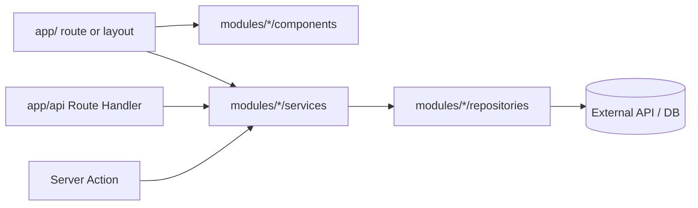

# Stack: Next.js App Router

Snippets for `{{STACK:<name>}}` markers. Each `###` section body replaces the marker with the same name. Based on a Next.js 16 App Router project with React 19, TypeScript, Tailwind CSS v4, Vitest, and Playwright. Commands use the `{{RUN:…}}`, `{{EXEC:…}}`, and `{{DLX:…}}` forms from step 3 of `APPLY.md` and never name a package manager; check each script name against `package.json`.

`lighthouse-collect`: Lighthouse starts the production server itself (`next start`) on a dedicated port, so build first. Add the key routes (1–5 public, representative URLs) to `url`.

### profile-defaults

| Variable | Typical value |
| --- | --- |
| `{{FRAMEWORK_DOCS}}` | `` `node_modules/next/dist/docs/` `` (the guides for the installed version) |
| `{{SOURCE_DIR}}` | `` `app/` (routes) and `modules/` (features) `` |
| `{{STYLE_TOKENS_FILE}}` | `app/globals.css` |
| `{{E2E_DIR}}` / `{{E2E_CONFIG}}` | `tests/e2e` / `playwright.config.ts` |
| `{{CMD_DEV}}` / `{{CMD_BUILD}}` | `{{RUN:dev}}` / `{{RUN:build}}` |
| `{{CMD_LINT}}` / `{{CMD_TYPECHECK}}` | `{{RUN:lint}}` / `{{RUN:typecheck}}` |
| `{{CMD_TEST}}` / `{{CMD_TEST_WATCH}}` / `{{CMD_TEST_FILE}}` | `{{RUN:test}}` / `{{RUN:test:watch}}` / `{{RUN:test <file>}}` |
| `{{CMD_TEST_RELATED}}` / `{{CMD_LINT_FILES}}` | `{{EXEC:vitest related --run <files>}}` / `{{EXEC:eslint --cache <files>}}` |
| `{{CMD_E2E}}` | `{{EXEC:playwright test}}` |

### toolchain

- Next.js App Router (`app/` at the repo root), React, TypeScript `strict`, Tailwind CSS v4, ESLint flat config (`eslint.config.mjs`).
- Import alias: `@/*` maps to the repo root.
- Before using any Next.js API (routing, caching, data fetching, Server Actions, metadata, config), read the matching guide in `node_modules/next/dist/docs/`. The installed version may differ from training data.
- `next dev` writes and re-adds the `<!-- BEGIN:nextjs-agent-rules -->` block in `AGENTS.md`. Leave it in place.

### architecture

- Keep `app/` thin: routes, layouts, and route-level composition. Put feature code outside `app/` and import it.
- Default to Server Components; add `"use client"` only where interactivity or browser APIs require it, and keep client boundaries as low in the tree as possible.
- Server Components, Route Handlers, and Server Actions call services directly. The app never calls its own HTTP API from the server.
- Validate all external input at the boundary (Route Handler, Server Action, repository response).

### ui-rules

- One component per file where practical. Typed props. Keep components focused; extract logic when a component grows or mixes concerns.
- Avoid deeply nested component definitions in a single file.
- Co-locate component and behavior tests next to the code they cover.
- Semantic HTML and native controls first; every control has an accessible name and visible focus. Do not convey meaning by color alone.

```tsx
type PropsT = {
  title: string;
};

export default function WelcomeHello(props: PropsT) {
  const { title } = props;

  return <h1>{title}</h1>;
}
```

### test-layers

- Unit and component tests: Vitest + Testing Library, co-located as `*.test.ts` / `*.test.tsx`. Test pure logic and services without network or real providers; use fakes or mocks at external boundaries only.
- End-to-end tests: Playwright, in `tests/e2e/*.spec.ts`. Use them for user-visible flows across routes, and for async Server Components, which Vitest cannot render.

### testing-map

| Behavior | Layer |
| --- | --- |
| Business rule, calculation, mapping, validation | Vitest unit test on the service |
| Client Component interaction or rendering | Vitest + Testing Library |
| Synchronous Server Component rendering | Vitest + Testing Library |
| Route Handler | Vitest (call the handler) or E2E |
| Async Server Component, routing, redirects, full flow | Playwright E2E |

Vitest does not support async Server Components. Cover them with E2E, and keep their logic in services that can be unit tested.

### layout

```txt
app/                      # Routes, layouts, route-level composition only
  (group)/route/page.tsx
  api/<resource>/route.ts # Route Handlers: parse, validate, delegate to services
modules/
  <feature>/
    components/           # UI pieces for this feature (+ co-located *.test.tsx)
    services/             # Business logic and orchestration (+ *.test.ts)
    repositories/         # Data access behind a narrow interface
    types/
    mocks/                # Fakes used by tests
shared/                   # Only code that is genuinely reused by 2+ modules
tests/
  e2e/                    # Playwright specs, pages/, helpers/, fixtures/
docs/                     # All project documentation except the root files
```



### testing-setup

Unit and component tests, installed with the "Add a dev dependency" form from the Toolchain section of `AGENTS.md`: `vitest`, `@vitejs/plugin-react`, `jsdom`, `@testing-library/react`, `@testing-library/dom`, `@testing-library/jest-dom`, `@testing-library/user-event`.

`vitest.config.mts`:

```ts
import { defineConfig } from "vitest/config";
import react from "@vitejs/plugin-react";

export default defineConfig({
  plugins: [react()],
  resolve: { tsconfigPaths: true },
  test: {
    environment: "jsdom",
    setupFiles: ["./vitest.setup.ts"],
    // Explicit include keeps Vitest away from Playwright *.spec.ts files.
    include: ["**/*.test.{ts,tsx}"],
    exclude: ["node_modules/**", ".next/**", "tests/e2e/**"],
  },
});
```

`vitest.setup.ts`:

```ts
import "@testing-library/jest-dom/vitest";
import { cleanup } from "@testing-library/react";
import { afterEach } from "vitest";

afterEach(() => {
  cleanup();
});
```

Conventions: query the DOM by role and accessible name, then label, then text, test ID last. Simulate interactions with `@testing-library/user-event`. Node-only tests can declare `// @vitest-environment node`.

End-to-end tests (`@playwright/test` with Chromium; run the `e2e-install` command once per machine):

`playwright.config.ts`:

```ts
import { defineConfig, devices } from "@playwright/test";

const PORT = 3107;
const BASE_URL = `http://127.0.0.1:${PORT}`;
const PROD = Boolean(process.env.CI || process.env.E2E_BUILD);

export default defineConfig({
  testDir: "./tests/e2e",
  fullyParallel: true,
  forbidOnly: Boolean(process.env.CI),
  retries: process.env.CI ? 1 : 0,
  // An auto-opened HTML report keeps the process alive after a failure.
  reporter: [["list"], ["html", { open: "never" }]],
  use: {
    baseURL: BASE_URL,
    trace: "retain-on-failure",
    screenshot: "only-on-failure",
  },
  projects: [{ name: "chromium", use: { ...devices["Desktop Chrome"] } }],
  webServer: {
    // Iteration runs against the dev server; e2e-build and CI against a production build.
    command: PROD
      ? `{{RUN:build}} && {{RUN:start --hostname 127.0.0.1 --port ${PORT}}}`
      : `{{RUN:dev --hostname 127.0.0.1 --port ${PORT}}}`,
    url: BASE_URL,
    reuseExistingServer: false,
    timeout: PROD ? 180_000 : 60_000,
    env: {
      // Test-only values and fake providers go here. Never real secrets.
    },
  },
});
```

The dedicated port avoids clashing with the `dev` command on 3000. Only `e2e-build` and CI pay for the build; caching and rendering can differ between dev and production, which is why the final run uses `e2e-build`.

`package.json` scripts and `engines`:

```json
{
  "engines": { "node": ">=24" },
  "scripts": {
    "typecheck": "tsc --noEmit --incremental",
    "test": "vitest run",
    "test:watch": "vitest",
    "test:e2e": "playwright test",
    "test:e2e:ui": "playwright test --ui",
    "test:e2e:report": "playwright show-report"
  }
}
```

`.gitignore` additions: `*.tsbuildinfo`, `.eslintcache`, `/test-results/`, `/playwright-report/`, `/blob-report/`, `/playwright/.cache/`, and `!.env.example` after `.env*`.

### e2e-gotchas

**Server-side fetches:** `page.route()` only intercepts requests made by the browser. Fetches made by Server Components, Route Handlers, or Server Actions run on the Next.js server and are invisible to it. Fake those through test-only env vars in `webServer.env` (for example, pointing a provider base URL at a local fake) or a fake adapter selected by env.

**Hydration:** in client-interactive pages, assert an element that only appears or enables after hydration before interacting; a click before hydration does nothing.

| Symptom | Typical cause | Fix |
| --- | --- | --- |
| `page.route` mock has no effect | Request is made on the Next.js server | Fake through `webServer.env` or a fake adapter |
| Click does nothing right after load | Interaction before hydration | Assert a hydrated-only state first |
| `webServer` dev command exits at startup | Another `next dev` already runs for the project | Stop it, or run `e2e-build` |
| Passes with `e2e`, fails with `e2e-build` | Behavior differs between dev and production (caching, static rendering) | Fix for production; `e2e-build` is the reference |

### performance

- Content images use `next/image` with `sizes`; mark the LCP image as a priority image the way the installed version's `next/image` docs describe.
- Fonts use `next/font`, which self-hosts them and prevents layout shift.
- Titles, descriptions, and canonical URLs come from the Metadata API (`metadata` or `generateMetadata`); `app/robots.ts` generates `robots.txt`.
- Third-party scripts use `next/script` with `afterInteractive` or `lazyOnload`. Heavy client components load with `next/dynamic`.

### lighthouse-collect

      "startServerCommand": "{{RUN:start --port 9001}}",
      "url": ["http://localhost:9001/"],
