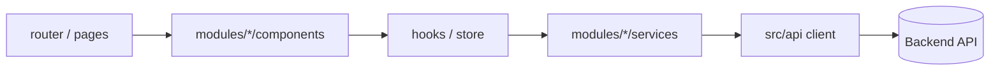

# Stack: Vite + React (SPA)

Snippets for `{{STACK:<name>}}` markers. Based on a Vite + React single-page app with React Router, Redux, MUI, Vitest, and Playwright under `e2e/`. Values marked "verify" differ between projects; confirm them in step 1 of `APPLY.md`. Commands use the `{{RUN:…}}`, `{{EXEC:…}}`, and `{{DLX:…}}` forms from step 3 of `APPLY.md` and never name a package manager; check each script name against `package.json`.

### profile-defaults

| Variable | Typical value |
| --- | --- |
| `{{FRAMEWORK_DOCS}}` | `https://vite.dev/guide/` and `https://react.dev/reference` (no local copy; match the installed majors in `package.json`) |
| `{{SOURCE_DIR}}` | `` `src/` `` |
| `{{STYLE_TOKENS_FILE}}` | `src/index.css` (verify; may be a theme file such as `src/theme.ts`) |
| `{{E2E_DIR}}` / `{{E2E_CONFIG}}` | `e2e/tests` / `e2e/playwright.config.ts` |
| `{{CMD_DEV}}` / `{{CMD_BUILD}}` | `{{RUN:dev}}` / `{{RUN:build}}` |
| `{{CMD_LINT}}` / `{{CMD_TYPECHECK}}` | `{{RUN:lint}}` / `{{EXEC:tsc --noEmit}}` (or `n/a` in a JavaScript project) |
| `{{CMD_TEST}}` / `{{CMD_TEST_WATCH}}` / `{{CMD_TEST_FILE}}` | `{{EXEC:vitest run}}` / `{{RUN:test}}` / `{{EXEC:vitest run <file>}}` |
| `{{CMD_E2E}}` | `{{EXEC:playwright test --config=e2e/playwright.config.ts}}` |

### toolchain

- Vite with `@vitejs/plugin-react`, React function components and hooks, ESLint, Prettier.
- Only `VITE_*` variables reach the browser bundle. Never put a secret in a `VITE_*` variable; the app is a pure frontend and every value shipped is public.
- `import.meta.env.DEV` gates dev-only features; Rollup drops that code from `vite build`. A Vite plugin with `apply: 'serve'` is the dev-only backend pattern when one is needed.

### architecture

- The app is a pure SPA: there is no server code. All backend access goes through an API client layer (`src/api/` or `services/` inside a module); components never call `fetch`/`axios` directly.
- Routes live in `src/router/`; feature code in `src/modules/<feature>/`; shared UI in `src/components/`; shared hooks and helpers in `src/hooks/` and `src/helpers/`.
- Keep global state (Redux or equivalent) to what several modules share; feature state stays in the feature.

### ui-rules

- One component per file where practical. Typed props when the project uses TypeScript; `propTypes` or JSDoc otherwise, matching nearby files.
- Keep components focused; extract hooks when a component mixes data loading and presentation.
- Co-locate tests (`*.test.jsx|tsx` or `__tests__/`) following the project's existing placement.
- Semantic HTML and native controls first; every control has an accessible name and visible focus. Do not convey meaning by color alone. Respect the UI library's accessibility props (labels, `aria-*`) instead of custom markup.

### test-layers

- Unit and component tests: Vitest + Testing Library in jsdom, co-located with the code. Test hooks, reducers, selectors, and services without network; fake the API client at its boundary.
- End-to-end tests: Playwright under `e2e/`, with its own `playwright.config.ts` and `tsconfig.json`. Because everything runs in the browser, `page.route()` can intercept every API call when a mock is justified.

### testing-map

| Behavior | Layer |
| --- | --- |
| Reducer, selector, helper, validation, API mapping | Vitest unit test |
| Component rendering and interaction, custom hook | Vitest + Testing Library |
| Routing, guards, multi-page flow, third-party widgets | Playwright E2E |

### layout

```txt
src/
  api/                    # API client and endpoint wrappers
  components/             # Shared UI pieces
  helpers/
  hooks/
  layout/
  modules/
    <feature>/
      components/         # UI for this feature (+ co-located tests)
      services/           # Orchestration and API calls for this feature
      hooks/
      __tests__/          # When the project keeps tests here instead of co-located
  pages/                  # Route-level composition
  router/                 # Route definitions and guards
e2e/
  playwright.config.ts
  tsconfig.json
  fixtures/  helpers/  pages/  tests/
docs/
```



### testing-setup

Unit and component tests (`vitest`, `jsdom`, `@testing-library/react`, `@testing-library/dom`, `@testing-library/jest-dom`, `@testing-library/user-event`):

```js
// vite.config.js (test block) or vitest.config.js
export default defineConfig({
  plugins: [react()],
  test: {
    environment: 'jsdom',
    globals: true,
    setupFiles: ['./src/setupTests.js'],
    include: ['src/**/*.{test,spec}.{js,jsx,ts,tsx}'],
    exclude: ['node_modules/**', 'dist/**', 'e2e/**'],
  },
});
```

The explicit `include` under `src/` keeps Vitest away from Playwright specs in `e2e/`. `src/setupTests.js` imports `@testing-library/jest-dom/vitest` and calls `cleanup` after each test.

End-to-end tests (`@playwright/test`; run the `e2e-install` command once per machine). `e2e/playwright.config.ts`:

```ts
import { defineConfig, devices } from '@playwright/test';
import { config } from 'dotenv';

config({ path: '.env' }); // Playwright runs from the repo root

const PORT = 4173;
const BASE_URL = process.env.VITE_E2E_BASE_URL ?? `http://localhost:${PORT}`;
const isRemote = Boolean(process.env.VITE_E2E_BASE_URL);

export default defineConfig({
  testDir: './tests',
  fullyParallel: !isRemote,
  retries: process.env.CI ? 1 : 0,
  reporter: [['list'], ['html', { outputFolder: 'playwright-report', open: 'never' }]],
  outputDir: 'test-results',
  use: {
    baseURL: BASE_URL,
    trace: 'retain-on-failure',
    screenshot: 'only-on-failure',
  },
  projects: [{ name: 'chromium', use: { ...devices['Desktop Chrome'] } }],
  // Against a remote environment no local server is started.
  webServer: isRemote
    ? undefined
    : {
        command: `{{RUN:build}} && {{RUN:preview --port ${PORT} --strictPort}}`,
        port: PORT,
        reuseExistingServer: false,
        timeout: 120_000,
      },
});
```

`vite preview` serves the production build, so a run never tests a stale dev server. Set `VITE_E2E_BASE_URL` to point the same specs at a deployed environment. Specs that run against a shared backend with real data should set `workers: 1` and avoid parallelism.

`package.json` scripts:

```json
{
  "scripts": {
    "test": "vitest",
    "test:e2e": "playwright test --config=e2e/playwright.config.ts",
    "test:e2e:ui": "playwright test --config=e2e/playwright.config.ts --ui",
    "test:e2e:debug": "playwright test --config=e2e/playwright.config.ts --debug"
  }
}
```

`.gitignore` additions: `e2e/test-results/`, `e2e/playwright-report/`, `playwright/.cache/`, `e2e/.env`.

### e2e-gotchas

**Everything is client-side:** `page.route()` can mock any API call. Still prefer the real API for steps that create state used later; mock only external boundaries (payments, signature, email) or to force a deterministic error.

**Persisted stores:** with `redux-persist` or similar, editing `localStorage` directly does not reset the in-memory store. Sign out through the UI to reach a public route again.

**Portals and overlays:** MUI menus, selects, and dialogs render in portals at the end of `body`. Scope locators to `getByRole('dialog')`, `getByRole('listbox')`, or the open menu, and wait for toasts to be hidden before critical clicks.

| Symptom | Typical cause | Fix |
| --- | --- | --- |
| Public route redirects after a successful login | Session persisted in the store | Sign out via the UI, not `localStorage.clear()` |
| Select option not found | Options render in a portal | Locate inside `getByRole('listbox')` after opening |
| Specs hit a stale build | Reused dev server | `reuseExistingServer: false` with `vite preview` |
